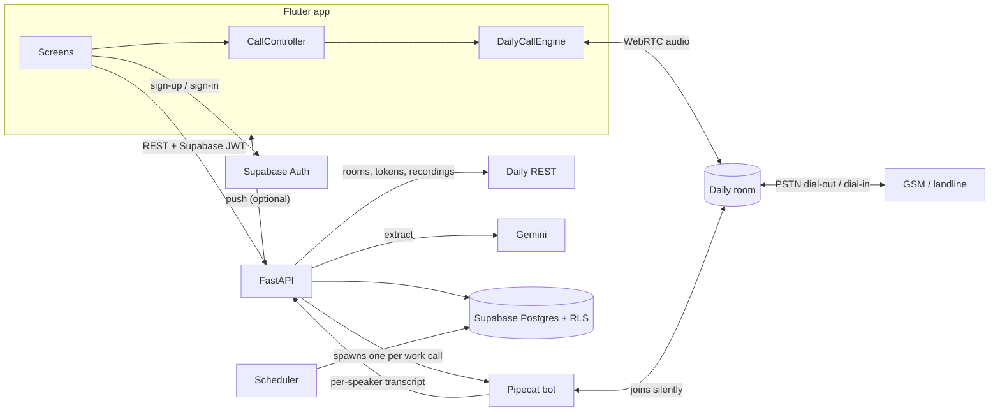

# Commit AI

**Business calling that remembers every commitment.**

Employees call clients from one mobile app: app-to-app over the internet, or to any GSM mobile or
landline. Work calls are recorded and transcribed. An AI listener catches every commitment made on the
call ("I'll send the revised invoice tomorrow morning"), turns it into a tracked item with a real
deadline and the exact words that were said, and puts it on a dashboard so managers can see what is due,
what slipped, and who to follow up with.

One phone, two identities. In **Personal** mode calls are recorded only for the user's own
commitments, which stay private to them (they can switch this off). **Work** mode is entered with a
company login; work calls and their commitments are shared with the employee's managers. While Work
mode is on, personal calls are held, not rung.

---

## Contents

1. [Features](#features)
2. [Tech stack](#tech-stack)
3. [How it works](#how-it-works)
   - [Architecture](#architecture)
   - [Call types](#call-types)
   - [Personal / Work routing rules](#personal--work-routing-rules)
   - [How commitments are extracted](#how-commitments-are-extracted)
   - [Accountability loop](#accountability-loop)
   - [Security and privacy](#security-and-privacy)
4. [Repository layout](#repository-layout)
5. [Getting started](#getting-started)
   - [Prerequisites and accounts](#prerequisites-and-accounts)
   - [1. Offline demo (app only)](#1-offline-demo-app-only)
   - [2. Database (Supabase)](#2-database-supabase)
   - [3. Server](#3-server)
   - [4. App against your server](#4-app-against-your-server)
   - [5. Testing on real phones](#5-testing-on-real-phones)
6. [Configuration reference](#configuration-reference)
7. [API overview](#api-overview)
8. [Testing](#testing)
9. [Deploying to production](#deploying-to-production)
10. [Branding assets](#branding-assets)
11. [Troubleshooting](#troubleshooting)
12. [Status, limits and roadmap](#status-limits-and-roadmap)

---

## Features

**For employees**
- **One app, two modes.** Personal and Work, each with its own contacts, call history and colour
  (sea-glass green for Personal, Commit blue for Work), so you always know which identity you're
  calling from.
- **Call anyone.** Free app-to-app calls to other Commit AI users (added by email), and calls to GSM
  mobiles and landlines (via Daily's phone network).
- **Live hints during the call.** "Commitment detected · by Friday" cards appear as you speak.
  A **Flag commitment** button marks a moment the AI should look at closely.
- **Post-call review.** Right after hanging up, confirm, edit, re-date or drop what the AI found, or add
  one it missed. Low-confidence items are marked. Nothing reaches a manager before you've had the chance
  to review (unreviewed items auto-publish after 24 hours so managers are never left blind).
- **Real deadlines.** "By Friday", "tomorrow morning", "next Tuesday", "end of the month" are resolved
  against the call time in the company's timezone (default Africa/Lagos).
- **The exact quote** on every commitment, with its time in the call, so disputes are settled by what
  was actually said.
- **Both sides tracked.** What the *client* promised ("I'll send the PO") is tracked as "client owes us"
  and never counts against the employee.
- **Personal calls tracked too, privately.** Personal calls are recorded and their commitments extracted
  for the user alone: they appear on the Commitments tab in Personal mode and never reach the company,
  managers or colleagues (enforced by the database). A **Record my personal calls** switch turns it off.
- **Deadline reminders on the phone:** a day before and 2 hours before every dated commitment, scheduled
  on the device so they arrive even when the app is closed and without push set up; plus a "deadline
  passed" notice. (With push configured, the server sends the same reminders by push too.)
- **Import phone contacts** (Personal mode): with permission, the phone's address book is imported into
  the user's private contacts; numbers are normalised (`0803…` → `+234803…`), duplicates skipped, and
  contacts who use Commit AI are marked for free app calls. In Work mode, a client can be picked from the
  phone's contacts.
- The employee's own reliability score.
- **"While you were at work" digest.** Switching back to Personal shows who tried to reach you.
- **Biometric re-entry.** A Work session lasts 12 hours; within it, switching back to Work takes a
  fingerprint / Face ID instead of the PIN.

**For managers**
- **Team overview:** on-time rate, overdue items, open commitments, client calls, an 8-week
  made / kept / missed trend, open items by type, people ranked by reliability, and calls with negative
  sentiment that need attention.
- **All staff commitments in one register:** search (commitment, client, person, quote), filter (open,
  overdue, due in 7 days, awaiting review, client owes us, kept, missed), filter by person and type,
  sort, group by person, and one-tap **Nudge** that pushes the exact commitment to the employee.
- **Audit trail** on every commitment (created, confirmed, re-dated, status changes, comments, nudges).

**For the company**
- **Recording disclosure:** the bot announces the recording to both sides on every work call (wording
  set per company).
- **Off-duty handling:** a client ringing an employee's work number while they're in Personal mode
  goes to an AI voicemail; the message becomes a "call the client back" commitment. An on-duty employee
  who doesn't answer within 30 seconds also falls back to voicemail.
- **Retention:** transcripts are deleted after the company's `retention_days`; commitments are kept.

**Platform**
- Offline **demo mode** (no backend): a simulated company, a scripted client call with live hints, AI
  review and a manager dashboard.
- Onboarding (two identities → what happens on work calls → permissions → join your company),
  email sign-up / sign-in with password reset, offline / server-unreachable handling.

---

## Tech stack

| Part | Technology | Where |
|---|---|---|
| Mobile app | Flutter 3.41 (Dart 3.11), Material 3, no state-management library (ChangeNotifier) | `app/` |
| Voice calls | [Daily](https://www.daily.co) WebRTC (`daily_flutter` 0.41), Daily PSTN dial-out / pinless dial-in | `app/lib/call/`, `server/commitai/daily.py` |
| API | Python 3.12, FastAPI, Uvicorn, httpx, Pydantic 2 | `server/commitai/api.py` |
| Call bot | [Pipecat](https://github.com/pipecat-ai/pipecat) 1.16 + Daily transport (`daily-python`) | `server/commitai/bot.py` |
| Transcription | Daily's built-in per-participant transcription (Deepgram `nova-3-general`) | bot |
| AI extraction | Google **Gemini** (`gemini-3.5-flash-lite` by default) with a JSON schema; OpenAI-compatible models as an alternative; rule-based fallback | `server/commitai/extractor.py` |
| Bot voice | Gemini text-to-speech (`gemini-3.8-flash-lite-tts`) via the Interactions API, cached | `server/commitai/voice.py` |
| Database & auth | Supabase (Postgres 17, Row-Level Security, Supabase Auth with ES256 JWTs) | `supabase/migrations/` |
| Push (optional) | Firebase Cloud Messaging HTTP v1 + `flutter_callkit_incoming` | `server/commitai/push.py`, `app/lib/services/push_service.dart` |
| Phone numbers | `phonenumbers` (libphonenumber) for E.164 validation and mobile/landline detection | API |
| Fonts | Fraunces (display), Manrope (UI), JetBrains Mono (figures) via `google_fonts` | `app/lib/core/theme.dart` |

---

## How it works

### Architecture



- **Daily carries every call.** Phones join a private Daily room with short-lived tokens; GSM/landline
  legs are bridged into the same room by Daily's phone network.
- **The bot is a silent participant** that joins work calls only. It starts Daily cloud recording,
  plays the recording disclosure, enables per-speaker transcription, sends live hints to the employee,
  and posts the labelled transcript to the API when the call ends. For personal calls to phone numbers
  it only dials; nothing is recorded.
- **The API** owns identity, routing rules, rooms and tokens, extraction, the dashboard and the
  accountability loop. It writes to Supabase with the service-role key; the app never writes call data
  directly.

### Call types

| Call | How it connects | Recorded / extracted |
|---|---|---|
| **App → app** (internet) | Both phones join the same Daily room. The callee is rung by push, or (without push) by the app polling `GET /v1/calls/incoming` every 3 s while open. | Each side separately: Work mode → company commitments; Personal mode → private commitments (unless switched off) |
| **App → GSM mobile / landline** | The bot asks Daily to dial out from the room (`start_dialout`) with the company number as caller ID. | Work → company; Personal → private (unless switched off) |
| **GSM / landline → work number** | Daily pinless dial-in calls `POST /webhooks/daily/dialin` (HMAC-signed). The server finds the employee who owns the number and either rings them or sends the caller to AI voicemail. | Yes (it's a corporate number) |

Numbers are validated and classified (mobile vs landline) with libphonenumber, for any country.

### Personal / Work routing rules

Implemented as a pure function in `server/commitai/routing.py`:

| Callee is in | Incoming call is | Result | Recorded |
|---|---|---|---|
| Work | corporate (work call, corporate number, or a listed client) | rings | yes, for the company |
| Work | personal (friend, family) | **held**: the caller is told they're at work; shown later in the digest | no |
| Personal | personal | rings | yes, privately for the user (unless switched off) |
| Personal | corporate | company policy: `voicemail` (default) or `ring` | voicemail is transcribed |

Work-mode recordings produce company commitments (visible to managers); Personal-mode recordings produce
private commitments (owner only, `org_id` is null). Whenever anyone on the call records, the bot tells
both sides the call is recorded. Personal and Work histories, contacts, commitments and recents never mix.
For an app-to-app **work** test, both people must be in Work mode.

### How commitments are extracted

1. **Transcript.** Daily transcribes each participant separately; the bot labels every line
   *employee* or *client* (anyone who isn't the employee's app account, e.g. a phone caller, is the
   client). Lines split mid-sentence by live transcription are re-joined.
2. **AI pass.** Gemini receives the call date, weekday and company timezone, the speaker-labelled
   transcript, any moments the employee flagged, and a strict JSON schema. It returns each commitment's
   title, owner (employee / client), exact quote, deadline, category, priority and confidence, plus a
   manager summary and sentiment. The prompt treats the transcript as data, so a speaker saying
   "ignore your instructions" can't steer it. Rate limits and server errors are retried with back-off.
3. **Grounding (our code, not the model):**
   - every quote must be found in the transcript; a close paraphrase is replaced with the real words,
     and a quote that can't be found is kept but marked low-confidence for the review;
   - spoken deadlines ("by Friday", "next Tuesday") are resolved by our own date code, which overrides
     the model's date arithmetic; deadlines before the call are dropped;
   - near-duplicates are merged; findings near a flagged moment get higher confidence.
4. **Safety net.** A rule-based detector also runs; a clear, unhedged promise it finds that the AI
   didn't report is added as a low-confidence item ("please confirm"). A missed commitment costs more
   than one extra item to dismiss.
5. **Fallback.** With no AI key, or if the AI keeps failing, the rule-based detector does the whole job,
   so a call's commitments are never lost.
6. **Voicemail** becomes a "call the client back" commitment, due the next business day at 12:00.

Everything lands as `pending_review`. The employee confirms or edits it; the scheduler auto-publishes
confident items left unreviewed for 24 hours.

### Accountability loop

**On the phone:** the app schedules local notifications for the user's own live commitments a day before
and 2 hours before each deadline (re-synced whenever data changes or the mode switches). These work with
the app closed and need no push setup.

**On the server**, the scheduler (in the API process) runs every 15 s for call housekeeping and every
`SCHEDULER_INTERVAL_S` (5 min) for the rest:
- push reminders `REMINDER_LEAD_HOURS` (24 h) and 2 h before a deadline (work and personal commitments);
- overdue items marked **missed**; the owner is told and, for work commitments, the manager is alerted;
- unreviewed confident findings auto-published after 24 h;
- unanswered calls expired after `RING_TIMEOUT_S`;
- calls whose transcript never arrived marked failed after 15 min;
- transcripts deleted after each company's `retention_days`.

### Security and privacy

- **Auth:** Supabase email accounts; the API verifies Supabase JWTs against the project's JWKS
  (ES256/RS256, or HS256 for legacy projects).
- **Work identity:** company code + employee ID + PIN (bcrypt). PIN attempts are rate-limited per user
  and per IP. A successful login mints a 12-hour corporate session stored in the phone's keystore
  (`flutter_secure_storage`); re-entry within it needs biometrics and falls back to the PIN.
- **Database:** Row-Level Security on every table. Personal calls can never belong to an organisation,
  and personal commitments are visible to their owner only (CHECK constraints + RLS). Colleagues can't see each other's calls; managers see their reports;
  admins see the company. App users can't read PIN hashes or other users' emails, and can't change
  their own Work/Personal state (only the API can). RLS helper functions live in a private schema.
- **Server:** with `APP_ENV=production` the API refuses to start with unsafe settings (dev login on,
  default internal key, no Supabase, non-HTTPS public URL, wildcard CORS). Daily dial-in webhooks are
  HMAC-verified. All inputs are validated. Bot → API calls use a shared internal key (constant-time
  comparison). Client failures can be reported to `POST /v1/diagnostics` for the server log.
- **Recording consent:** keep the disclosure on (`organizations.announce_recording`) and check the rules
  where you operate (e.g. Nigeria's NDPA 2023 and all-party-consent jurisdictions).

---

## Repository layout

```
app/                              Flutter app (Android, iOS; Windows for UI testing)
  lib/app.dart                    root: splash, offline screen, logo widgets, routing by auth status
  lib/core/                       config (build-time settings), theme, formatting
  lib/state/app_state.dart        session, Personal/Work switch, sign-in/up, onboarding, incoming calls
  lib/call/                       CallController, DailyCallEngine (the only file using the Daily SDK), demo engine
  lib/data/                       Backend interface, HTTP API client, offline demo backend
  lib/screens/                    auth (welcome, sign-in, onboarding, corporate login), home, call,
                                  commitments, team (dashboard + all-staff register)
  lib/widgets/                    shared UI (dock, cards, empty states, charts)
  assets/branding/                app icon / splash / logo art (+ source/ with the originals and build script)
  env/example.json                build settings template (real env/*.json files are git-ignored)
  setup.ps1                       one-time platform setup (permissions, minSdk, Info.plist)
server/
  commitai/api.py                 REST API, webhooks, bot callbacks, dashboard
  commitai/bot.py                 Pipecat call bot (recording, disclosure, transcription, hints, dial-out/in, voicemail)
  commitai/extractor.py           commitment extraction (Gemini / OpenAI / rules), grounding, deadlines
  commitai/voice.py               bot speech (Gemini TTS, cached)
  commitai/routing.py             Personal/Work call-routing policy
  commitai/scheduler.py           reminders, escalation, auto-publish, housekeeping, retention
  commitai/store.py               data access (Supabase PostgREST, or in-memory demo store)
  commitai/daily.py               Daily REST client (rooms, tokens, recordings)
  commitai/auth.py, config.py, push.py, seed.py, bot_runner.py
  scripts/create_test_accounts.py creates/resets two test accounts (asks for the password)
  tests/                          pytest suite
  .env.example                    every server setting, documented
  Dockerfile
supabase/migrations/              schema, RLS, hardening, later changes (apply in order)
```

---

## Getting started

### Prerequisites and accounts

| Needed for | What |
|---|---|
| App | Flutter 3.41+ (Dart 3.11), Android Studio / Android SDK (Java 21 JBR is fine); Xcode on a Mac for iOS |
| Server | Python 3.12 |
| Database & sign-in | A [Supabase](https://supabase.com) project |
| Calls | A [Daily](https://dashboard.daily.co) account with a payment method (recording, transcription and phone calls need one) |
| AI | A Gemini API key from [Google AI Studio](https://aistudio.google.com/apikey) (enable billing for real use; the free tier's speech quota is a few requests per day) |
| Phone calls to GSM/landline | A Daily phone number (US/Canada via the API) **or** your own carrier's numbers over SIP, plus Daily's dial-out approval |
| Background ringing (optional) | A Firebase project (FCM) |

### 1. Offline demo (app only)

No backend or keys needed.

```bash
cd app
flutter pub get
flutter run
```

Pick **Ada** (account manager) or **Ngozi** (head of sales). Tap **Work** and sign in with company
`LUMEN`, ID `EMP-1042` (Ada) or `EMP-1001` (Ngozi), PIN `1234`. Call **Ibrahim Bello** from Clients to see
live hints and the AI review; as Ngozi, open **Team**.

### 2. Database (Supabase)

1. Create a Supabase project.
2. Apply every file in `supabase/migrations/` **in filename order** (`supabase db push`, or paste each
   into the SQL editor).
3. In **Authentication → Providers → Email**, decide whether to require email confirmation (the app
   handles both).
4. Create your company and employees. Example (PINs are bcrypt-hashed with `pgcrypto`):

   ```sql
   insert into organizations (name, corp_code) values ('Acme Ltd', 'ACME') returning id;
   -- manager first, then employees reporting to them
   insert into memberships (org_id, employee_id, pin_hash, role, title)
   values ('<org id>', 'EMP-1001', extensions.crypt('1234', extensions.gen_salt('bf')), 'manager', 'Head of Sales')
   returning id;
   insert into memberships (org_id, employee_id, pin_hash, role, title, manager_id)
   values ('<org id>', 'EMP-1002', extensions.crypt('1234', extensions.gen_salt('bf')), 'employee', 'Account Manager', '<manager membership id>');
   ```

   An employee's account is linked to their membership the first time they sign in to Work mode with
   that company code, ID and PIN.
5. Note your project URL, the **publishable** key (for the app) and the **secret / service_role** key
   (for the server only; never ship it in the app).

### 3. Server

```bash
cd server
python -m venv .venv
.venv\Scripts\activate            # Windows   (macOS/Linux: source .venv/bin/activate)
pip install -r requirements.txt
copy .env.example .env            # macOS/Linux: cp .env.example .env
```

Fill in `.env` (see [Configuration reference](#configuration-reference)): at least `SUPABASE_URL`,
`SUPABASE_SERVICE_ROLE_KEY`, `DAILY_API_KEY`, `GEMINI_API_KEY` and a random `INTERNAL_API_KEY`
(`python -c "import secrets;print(secrets.token_urlsafe(48))"`). Then:

```bash
pytest                                     # unit + API tests (no network needed)
uvicorn commitai.api:app --host 127.0.0.1 --port 8000
```

`GET /health` shows which store, Daily, AI provider and bot settings are active.

With `SUPABASE_*` left empty the API runs on an in-memory copy of the demo company (`seed.py`);
with `DEV_AUTH=true` the app's dev build can sign in as the seeded users without Supabase.

**Test accounts:** `python scripts/create_test_accounts.py` creates (or resets)
`manager@commitai.test` → `EMP-1001` and `employee@commitai.test` → `EMP-1043` at the company `LUMEN`,
asking you for the password at the prompt.

### 4. App against your server

Build settings are compile-time values read from a JSON file:

```bash
cd app
copy env\example.json env\dev.json   # then edit it
```

```json
{
  "API_URL": "http://localhost:8000",
  "SUPABASE_URL": "https://YOUR-PROJECT.supabase.co",
  "SUPABASE_ANON_KEY": "sb_publishable_...",
  "DEV_LOGIN": "false"
}
```

```bash
flutter run --dart-define-from-file=env/dev.json                 # phone, emulator, or desktop
flutter build apk --release --dart-define-from-file=env/apk.json # installable APK
```

- An Android **emulator** reaches your PC at `http://10.0.2.2:8000`.
- **Release builds only allow HTTPS**, so a real phone needs the server on an HTTPS address (next step).
- **Windows desktop** (UI testing only; calls need a phone): run with
  `$env:CMAKE_POLICY_VERSION_MINIMUM='3.5'` first (the Firebase C++ SDK predates CMake 4).

### 5. Testing on real phones

The phones must reach the server over HTTPS. Two options:

- **Temporary (quick tunnel):** `cloudflared tunnel --url http://127.0.0.1:8000` prints an
  `https://….trycloudflare.com` address. Put it in `env/apk.json` as `API_URL` and build the APK.
  The address changes every time the tunnel restarts (and the APK must be rebuilt), and the PC must
  stay on and awake.
- **Stable (recommended):** a named Cloudflare Tunnel on your own domain (e.g. `api.yourdomain.com`),
  or deploy the server (see below). Build the APK once against that address.

Turn **`DEV_AUTH=false`** before exposing the server publicly.

Two-phone app-to-app test:
1. Install the APK on both phones; each signs in (or creates an account).
2. For a recorded call, both switch to **Work** (company code, employee ID, PIN).
3. One adds the other under **Clients → +** using their account **email**, then taps the contact →
   **App call**. Keep the app open on the receiving phone (without push it only rings while open).
4. Say a commitment ("I'll send you the proposal by Friday"), hang up, and check the review screen;
   the manager sees it under **Team → Commitments**.

---

## Configuration reference

### Server (`server/.env`)

| Setting | Purpose | Default |
|---|---|---|
| `APP_ENV` | `production` enforces safe settings and refuses to start otherwise | `development` |
| `PUBLIC_URL` | URL the bot uses to reach the API (and Daily webhooks) | `http://localhost:8000` |
| `INTERNAL_API_KEY` | shared secret for bot → API calls and corporate-session signing (32+ chars) | dev value |
| `DEV_AUTH` | accept `Bearer dev:<user id>` (local testing only) | `true` in development |
| `BOTS_ENABLED` | spawn the call bot (needed for recording, transcription and phone calls) | `true` |
| `CORS_ORIGINS` | browser origins allowed (mobile apps don't need this) | `*` in development |
| `LOGIN_MAX_ATTEMPTS` / `LOGIN_WINDOW_S` | corporate PIN attempts per user / IP per window | `5` / `900` |
| `RING_TIMEOUT_S` | unanswered app calls become missed | `60` |
| `DAILY_API_KEY` | Daily REST key | — |
| `DAILY_CALLER_ID` | purchased Daily number id used as caller ID for dial-out | — |
| `DAILY_RECORDING_TYPE` | `cloud` or `cloud-audio-only` | `cloud` |
| `DAILY_TRANSCRIPTION_MODEL` | Deepgram model for Daily transcription | `nova-3-general` |
| `DAILY_DIALIN_HMAC` | pinless dial-in webhook signing secret (required in production) | — |
| `AI_PROVIDER` | `gemini` or `openai` (empty = whichever has a key) | Gemini first |
| `GEMINI_API_KEY` | Google AI Studio key | — |
| `GEMINI_MODEL` | extraction model | `gemini-3.5-flash-lite` |
| `GEMINI_TTS_MODEL` / `GEMINI_TTS_VOICE` | bot voice | `gemini-3.8-flash-lite-tts` / `Kore` |
| `OPENAI_API_KEY` / `OPENAI_BASE_URL` / `EXTRACTION_MODEL` / `TTS_VOICE` | OpenAI-compatible alternative | — |
| `SUPABASE_URL` / `SUPABASE_SERVICE_ROLE_KEY` | database (empty = in-memory demo) | — |
| `SUPABASE_JWT_SECRET` | only for legacy HS256 projects (otherwise JWKS is used) | — |
| `FCM_PROJECT_ID` / `FCM_SERVICE_ACCOUNT_FILE` | push notifications | — |
| `REMINDER_LEAD_HOURS` / `SCHEDULER_INTERVAL_S` | accountability loop timing | `24` / `300` |
| `LOG_LEVEL` | server log level | `INFO` |

### App (`app/env/<name>.json`, passed with `--dart-define-from-file`)

| Key | Purpose |
|---|---|
| `API_URL` | the API's address. **Empty = offline demo mode.** |
| `SUPABASE_URL` / `SUPABASE_ANON_KEY` | sign-in (use the publishable key) |
| `TERMS_URL` / `PRIVACY_URL` | linked at sign-up; required for store review of an app that records calls |
| `PUSH_ENABLED` | `true` once Firebase is configured |
| `DEV_LOGIN` | show seeded dev users on the sign-in screen (servers with `DEV_AUTH=true`) |

---

## API overview

All `/v1` endpoints take `Authorization: Bearer <Supabase access token>`.

| Endpoint | Purpose |
|---|---|
| `GET /health` | status (store, Daily, AI provider, bots) |
| `GET /v1/me` | profile, current mode, membership, company |
| `POST /v1/corporate/login` | company code + employee ID + PIN → corporate session |
| `POST /v1/presence` | switch Personal / Work |
| `POST /v1/devices` | register a push token |
| `GET/POST /v1/contacts` | contacts (Personal) or company clients (Work); add by phone and/or email |
| `POST /v1/contacts/import` | import the phone's address book into personal contacts |
| `PATCH /v1/me/settings` | e.g. `record_personal_calls` |
| `POST /v1/calls` | start a call (`channel: app` or `pstn`) → room URL + token |
| `GET /v1/calls/incoming` | calls ringing for me (polled when push is off) |
| `POST /v1/calls/{id}/accept`, `/decline`, `/end` | call control |
| `POST /v1/calls/{id}/flags` | "flag commitment" moment |
| `GET /v1/calls`, `GET /v1/calls/{id}`, `GET /v1/calls/{id}/recording` | history, transcript + commitments, recording link |
| `POST /v1/calls/{id}/review` | confirm / edit / reject / add commitments |
| `GET /v1/commitments` | Personal mode: my private commitments; Work mode: mine or team (`scope=team`), filters |
| `PATCH /v1/commitments/{id}`, `POST …/comments`, `POST …/nudge`, `GET …/events` | update, comment, nudge, audit trail |
| `GET /v1/dashboard?days=30` | manager overview |
| `POST /v1/diagnostics` | client-side failure report (goes to the server log) |
| `POST /webhooks/daily/dialin` | Daily pinless dial-in (HMAC-signed) |
| `POST /internal/calls/{id}/events`, `/complete` | bot → API (internal key) |

With `APP_ENV` not production, interactive docs are at `/docs`.

---

## Testing

```bash
cd server && pytest          # routing, extraction & grounding, Gemini (mocked), API flows, privacy, scheduler, voice cache
cd app && flutter analyze && flutter test
```

The server suite needs no network or keys (Daily, Gemini and Supabase are mocked or in-memory).
The full live path (real Daily room → bot → recording → per-speaker transcript → Gemini → Supabase)
has been exercised end to end with simulated participants.

---

## Deploying to production

1. **Server:** build the `server/Dockerfile` image (it runs as a non-root user with a health check) on a
   small Linux VM or container host. Set `APP_ENV=production`, an HTTPS `PUBLIC_URL`,
   `DEV_AUTH=false`, a strong `INTERNAL_API_KEY`, Supabase, Daily, Gemini and `DAILY_DIALIN_HMAC`.
   Put it behind HTTPS (e.g. Cloudflare in front of your domain). Bots run as subprocesses of the API;
   at scale, point `bot_runner.spawn` at Pipecat Cloud or a worker pool (they only need `BOT_CONFIG` and
   the environment).
2. **Daily:** add a payment method, request dial-out approval, buy a number (or connect your carrier
   over SIP) and set `DAILY_CALLER_ID`; configure pinless dial-in to
   `https://<PUBLIC_URL>/webhooks/daily/dialin`; store each employee's direct number in
   `memberships.corporate_did`.
3. **Gemini:** enable billing on the key.
4. **Push:** create a Firebase project, add `google-services.json` / `GoogleService-Info.plist` to the
   app, set `FCM_*` on the server, build with `PUSH_ENABLED=true`. For reliable background ringing on
   iOS, add PushKit VoIP pushes.
5. **App release:** create `app/android/key.properties` (upload keystore; never commit it), set
   `TERMS_URL` / `PRIVACY_URL`, then `flutter build appbundle --release --dart-define-from-file=env/prod.json`.
   iOS builds need a Mac with Xcode.
6. **Data:** remove the test company (`LUMEN`), test accounts and test calls before real users.

---

## Branding assets

`app/assets/branding/` holds the generated icon, adaptive-icon layers, launch-screen art and in-app logo
images. `assets/branding/source/` has the original artwork and `build_brand_assets.py`, which rebuilds
everything from it. After changing the art:

```bash
cd app
dart run flutter_launcher_icons
dart run flutter_native_splash:create
```

---

## Troubleshooting

| Symptom | Cause / fix |
|---|---|
| "Can't reach the Commit AI server" | The server or tunnel isn't running, or the APK points at an old tunnel address. Check `GET /health` on the `API_URL`. |
| The other phone doesn't ring | Without push, the callee must have the app open. Check both are in the same mode (Work ↔ Work or Personal ↔ Personal). |
| Call connects but no audio / stuck connecting | Check microphone permission. The app now times out after 25 s and reports the failure to the server log (`APP PROBLEM …`). |
| No transcript / commitments after a work call | Check the bot started (server log), Daily has a payment method, and the Gemini key works. Calls whose transcript never arrives are marked failed after 15 min. |
| Gemini "retry after ~23 hours" | The free tier's daily text-to-speech quota is used up. Enable billing; cached phrases keep working. |
| Windows build: "Compatibility with CMake < 3.5 has been removed" | Set `$env:CMAKE_POLICY_VERSION_MINIMUM='3.5'` before `flutter run -d windows`. |
| Android build: "Cannot find a Java installation … languageVersion=17" | Already handled in `android/build.gradle.kts` (plugins compile with the installed JDK). |

---

## Status, limits and roadmap

**Working and verified:** sign-up / sign-in / onboarding against Supabase; Personal / Work modes and
routing; app-to-app call setup; recording, per-speaker transcription and Gemini extraction on real Daily
rooms; review, dashboard and all-staff register; private personal-call commitments, contact import and
two-stage deadline reminders; 51 server tests and the Flutter test suite.

**Known limits**
- Incoming calls only ring while the app is open until push (FCM / PushKit) is configured.
- Daily sells phone numbers for the US and Canada only. Nigerian numbers need a local carrier connected
  to Daily over SIP (e.g. a provider offering +234 numbers on a SIP trunk); that routing is not built yet.
- Moving PSTN dial-out from the bot to the server is planned (so a phone call connects even if the bot
  fails), pending a number to test with.
- A phone's own SIM calls can't be controlled by any app; "personal calls are held at work" applies to
  calls that go through Commit AI.
- The login rate limiter is per process; use a shared store (e.g. Redis) when running several API
  replicas.

**Roadmap:** simpler Work sign-in (company recognised from the work email, PIN only, invite links);
matching imported contacts by verified phone number (today by email); Nigerian numbers over SIP; push
notifications; production deployment on a stable domain.
